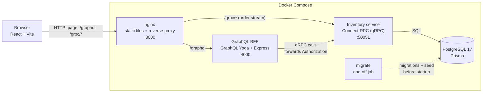
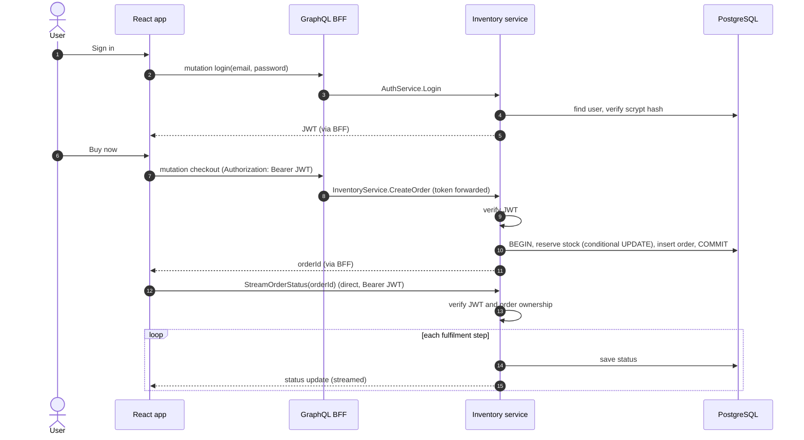
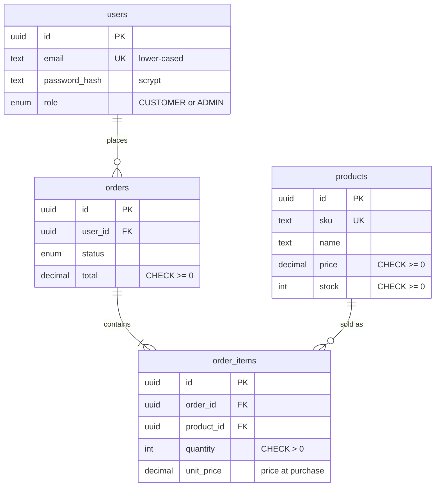

# E-commerce Stock Management

[](https://github.com/NoobSaibot11/E-commerse-Stock-Management/actions/workflows/ci.yml)

A full-stack inventory and checkout app built from a **React** frontend, a **GraphQL** backend-for-frontend (BFF) and a **gRPC** microservice backed by **PostgreSQL**. Users sign in with **JWT**, buy products without overselling stock, and watch their order progress live over a gRPC server stream.

**Tech stack:** TypeScript · React 19 + Vite · GraphQL Yoga · Connect-RPC (gRPC) · Protocol Buffers · PostgreSQL 17 + Prisma 7 · JWT (jose) · Vitest · Docker Compose · nginx · GitHub Actions

## Contents

- [Architecture](#architecture)
- [Quick start (Docker)](#quick-start-docker)
- [Local development](#local-development)
- [Testing](#testing)
- [Continuous integration](#continuous-integration)
- [API overview](#api-overview)
- [Data model](#data-model)
- [Design decisions](#design-decisions)
- [Project structure](#project-structure)
- [Configuration](#configuration)
- [Troubleshooting](#troubleshooting)
- [Limitations and next steps](#limitations-and-next-steps)

## Architecture



| Component | Responsibility |
|---|---|
| **React frontend** | Catalog, sign-in/register, checkout, live order tracking. Queries go through GraphQL; the order-status stream connects to the gRPC service directly. |
| **nginx** | Serves the built frontend and proxies `/graphql` and `/grpc/`, so the browser uses a single origin. Response buffering is off so stream updates arrive as they're sent. |
| **GraphQL BFF** | The API the frontend calls. Shapes data for the UI, forwards the caller's token to gRPC, and turns gRPC status codes into GraphQL error codes. Stores no data and checks no tokens itself. |
| **Inventory service (gRPC)** | Owns the database and all business rules: products, stock, orders, users, password hashing, JWT signing and verification, access control. |
| **PostgreSQL** | Source of truth, with constraints that enforce business rules even if application code is wrong. |

### Checkout and live tracking



## Quick start (Docker)

Requires [Docker Desktop](https://www.docker.com/products/docker-desktop/) (on Windows, with WSL 2).

```bash
docker compose up --build
```

Open **http://localhost:3000**. GraphiQL is at http://localhost:3000/graphql.

On startup Compose waits for PostgreSQL, runs migrations and seeds demo data in a one-off `migrate` container, then starts the gRPC service, the BFF and nginx in order, each after the previous one passes its health check.

**Demo accounts** (created by [`seed.ts`](services/grpc-server/prisma/seed.ts) for local use only):

| Email | Password | Role |
|---|---|---|
| `customer@example.com` | `customer-dev-password` | Customer |
| `admin@example.com` | `admin-dev-password` | Admin |

You can also register a new customer account from the UI.

```bash
docker compose down            # stop (data is kept)
docker compose down --volumes  # stop and delete the database
```

## Local development

Requires Node.js 26 (see [`.nvmrc`](.nvmrc)) and Docker for the database.

```bash
npm install
cp services/grpc-server/.env.example services/grpc-server/.env
npm run generate      # protobuf code (buf) + Prisma client
npm run db:up         # PostgreSQL only, on host port 5433
npm run db:migrate    # apply migrations
npm run db:seed       # demo products and accounts
```

Then run each service in its own terminal:

```bash
npm run dev:grpc       # gRPC service    http://localhost:50051
npm run dev:graphql    # GraphQL BFF     http://localhost:4000/graphql
npm run dev:frontend   # React app       http://localhost:5173
```

After changing a `.proto` file or `schema.prisma`, run `npm run generate` again. After a schema change, create a migration from `services/grpc-server` with `npx prisma migrate dev --name <change>`.

## Testing

```bash
npm test             # all backend tests (needs PostgreSQL running: npm run db:up)
npm run typecheck    # TypeScript across all three packages
npm run smoke        # end-to-end checks against the running Docker stack
```

| Suite | What it covers | How |
|---|---|---|
| [`inventory.test.ts`](services/grpc-server/test/inventory.test.ts) | Stock changes, all-or-nothing orders, price snapshots, input validation, **20 concurrent checkouts for 5 items never oversell**, database constraints | Real PostgreSQL |
| [`routes.test.ts`](services/grpc-server/test/routes.test.ts) | Every RPC, including the stream, plus the access rules (signed out, customer, other customer, admin) | Real handlers over an in-memory Connect transport |
| [`auth.test.ts`](services/grpc-server/test/auth.test.ts) | Password hashing, expired / forged / tampered / `alg: none` tokens, register, login, GetMe | Real PostgreSQL |
| [`schema.test.ts`](services/graphql-server/test/schema.test.ts) | GraphQL queries and mutations, token forwarding, error code mapping | Real schema, fake gRPC clients |
| [`smoke-test.mjs`](scripts/smoke-test.mjs) | 18 checks through nginx: CORS, login, checkout, live stream, access rules | Running Docker stack |

The database tests use a separate `ecommerce_test` database, created and migrated automatically. Test setup refuses to run against any database whose name doesn't end in `_test`, so development data is never wiped. Point tests elsewhere with `TEST_DATABASE_URL`.

## Continuous integration

[`.github/workflows/ci.yml`](.github/workflows/ci.yml) runs on every pull request and push to `main`:

1. **Type-check and test**: installs dependencies, generates code, type-checks all packages and runs the test suites against a PostgreSQL service container.
2. **Docker stack smoke test** (after step 1 passes): builds every image, starts the full Compose stack, waits for health checks and runs the smoke test through nginx. Service logs are printed if anything fails.

## API overview

### GraphQL (BFF)

```graphql
type Query {
  products: [Product!]!
  product(id: ID!): Product
  me: User                 # null when not signed in
}

type Mutation {
  register(email: String!, password: String!): AuthPayload!
  login(email: String!, password: String!): AuthPayload!
  checkout(productId: ID!, quantity: Int!): CheckoutResponse!   # requires sign-in
}
```

Send the token as `Authorization: Bearer <token>`. Errors carry a code in `extensions.code`: `UNAUTHENTICATED`, `FORBIDDEN`, `BAD_USER_INPUT` or `NOT_FOUND`.

### gRPC services ([`proto/ecommerce/v1`](proto/ecommerce/v1))

| RPC | Access |
|---|---|
| `AuthService.Register` / `Login` | Public |
| `AuthService.GetMe` | Signed in |
| `InventoryService.GetProducts` / `GetStock` | Public |
| `InventoryService.CreateOrder` | Signed in; the order belongs to the caller |
| `InventoryService.StreamOrderStatus` | The order's owner or an admin; other users get `NotFound` |
| `InventoryService.UpdateStock` | Admin only |

## Data model



Schema: [`schema.prisma`](services/grpc-server/prisma/schema.prisma) · Migrations: [`prisma/migrations`](services/grpc-server/prisma/migrations)

## Design decisions

**Stock can't be oversold.** Reserving stock is one conditional statement (`UPDATE … SET stock = stock - n WHERE id = $1 AND stock >= n`), so the check and the update happen atomically inside PostgreSQL. A multi-item order reserves every line in one transaction and rolls back entirely if any line is short; rows are locked in a fixed order so concurrent orders can't deadlock. A `CHECK (stock >= 0)` constraint backs this up at the database level. The concurrency tests fail if this is replaced with a read-then-write.

**The gRPC service owns authentication.** It is the only component with the JWT secret, and it verifies the token on every protected call. That matters because the browser calls it directly for the order stream; if only the BFF checked tokens, the stream would be unprotected. The BFF just forwards the `Authorization` header.

**Security details.** Passwords are hashed with salted scrypt (built into Node, so there's no native module to compile) and compared in constant time. Tokens are HS256 with the algorithm pinned, plus issuer, audience and a 1-hour expiry. Login returns the same message, in the same time, for an unknown email and a wrong password, so it can't be used to discover accounts. Another user's order is reported as `NotFound` rather than `PermissionDenied`, so order ids can't be probed.

**Money is exact.** Prices and totals are `NUMERIC`, not floating point, and each order line stores the price at the time of purchase so later price changes don't rewrite order history.

**One origin in production.** nginx serves the frontend and proxies both APIs, so there's no CORS in the Docker setup and only one port is published. In local development each server runs on its own port with CORS enabled.

**Contract-first API.** Protobuf definitions are the source of truth; TypeScript types for the server, BFF and browser client are generated from them with `buf`, so the three can't drift apart.

## Project structure

```
├── proto/ecommerce/v1/        # gRPC contracts (auth.proto, inventory.proto)
├── services/
│   ├── grpc-server/           # Inventory service: owns the database
│   │   ├── prisma/            # schema, migrations, seed
│   │   ├── src/
│   │   │   ├── auth/          # password hashing, JWT, auth RPCs, access guards
│   │   │   ├── inventory.ts   # data access and business rules
│   │   │   ├── routes.ts      # RPC handlers
│   │   │   └── server.ts      # HTTP server
│   │   └── test/
│   └── graphql-server/        # GraphQL BFF
│       ├── src/               # schema + resolvers, server
│       └── test/
├── frontend/src/              # React app (App, AuthPanel, api client)
├── scripts/smoke-test.mjs     # end-to-end checks
├── docker/nginx.conf
├── Dockerfile                 # multi-stage, one target per service
├── docker-compose.yml
└── .github/workflows/ci.yml
```

Generated code (`services/grpc-server/src/gen`, `src/generated`) isn't committed; `npm run generate` recreates it.

## Configuration

gRPC service ([`.env.example`](services/grpc-server/.env.example)):

| Variable | Purpose | Default |
|---|---|---|
| `DATABASE_URL` | PostgreSQL connection string | local Docker database on port 5433 |
| `JWT_SECRET` | Signs login tokens, at least 32 characters | dev-only value; **always replace outside local use** |
| `JWT_EXPIRES_IN` | Token lifetime | `1h` |
| `PORT` | Listen port | `50051` |

Other settings: `GRPC_URL` and `PORT` for the BFF; `VITE_GRAPHQL_URL` and `VITE_GRPC_URL` for the frontend build; `FRONTEND_PORT` (default `3000`) and `JWT_SECRET` for Docker Compose; `TEST_DATABASE_URL` for tests; `SEED_ADMIN_PASSWORD` and `SEED_CUSTOMER_PASSWORD` to override the demo passwords.

## Troubleshooting

- **"Authentication failed" connecting to the database:** another PostgreSQL may be using port 5432. This project's database is published on **5433** for that reason; check `DATABASE_URL` uses 5433.
- **Port 3000 already in use:** `FRONTEND_PORT=3001 docker compose up --build`.
- **Imports from `src/gen` or `src/generated` fail:** run `npm run generate`.
- **Docker Desktop won't start on Windows:** it needs WSL 2. Run `wsl --install --no-distribution` in an administrator terminal and restart.

## Limitations and next steps

- No refresh tokens: users sign in again after the token expires.
- No rate limiting on login.
- The token is kept in `localStorage`. An httpOnly cookie would protect it from scripts on the page but needs CSRF protection.
- Order fulfilment is simulated by the status stream rather than driven by a real workflow.
- Backend images run TypeScript with `tsx` and include dev dependencies (about 1.3 GB). A compiled, production-only image would be much smaller.
- CI builds images but doesn't publish them to a registry or deploy them.
